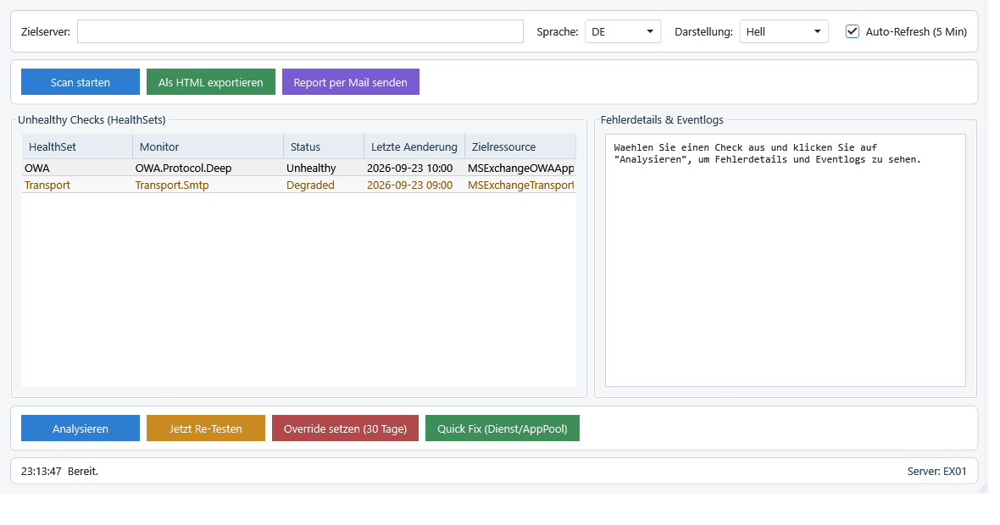
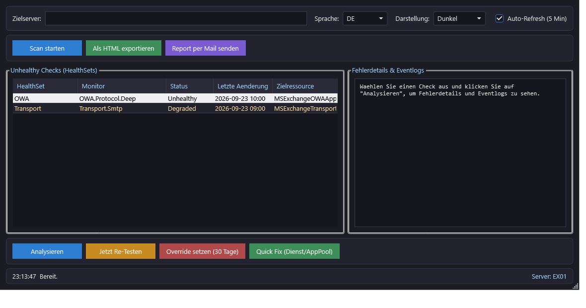

<div align="center">

# Exchange HealthReport Analyzer

**WPF-GUI-Werkzeug für Exchange Managed Availability (Server Health) · Exchange Server 2019 & Subscription Edition**

[](LICENSE)
[](https://learn.microsoft.com/powershell/)
[](https://www.microsoft.com/windows-server)
[](https://learn.microsoft.com/exchange/)
[](https://learn.microsoft.com/dotnet/desktop/wpf/)
[](#-deutsch)
[](CHANGELOG.md)

[Deutsch](#-deutsch) · [English](#-english) · [Changelog](CHANGELOG.md) · [Lizenz](LICENSE)

</div>

---

## 🇩🇪 Deutsch

### Überblick

`Exchange-HealthReport-Analyzer.ps1` ist ein vollständiges, eigenständiges GUI-Werkzeug (WPF, XAML direkt im Skript) zur **Analyse und Verwaltung von Exchange Managed Availability** – also Server Health, HealthSets, Monitore und Probes – auf **Exchange Server 2019** und **Exchange Server Subscription Edition (SE)**.

Das Skript zeigt ausschließlich ungesunde Health-Checks, führt auf Wunsch eine Deep-Dive-Analyse inklusive passender ActiveMonitoring-Eventlogs durch und bietet die wichtigsten Admin-Aktionen: Probe neu ausführen, Monitoring-Override setzen, betroffene Dienste/AppPools neu starten. Ergebnisse lassen sich als professioneller HTML-Report exportieren oder direkt per E-Mail versenden. Sprache (DE/EN) und Darstellung (Hell/Dunkel) sind zur Laufzeit umschaltbar.

### Screenshots

| Helle Darstellung (Standard) | Dunkle Darstellung |
| :---: | :---: |
|  |  |

### Funktionsumfang

| Bereich | Funktion |
| --- | --- |
| **Header** | Zielserver (Standard `$env:COMPUTERNAME`), Sprachumschalter DE/EN, Darstellung Hell/Dunkel, Auto-Refresh (5 Min) |
| **Toolbar** | „Scan starten" (`Get-HealthReport`), „Als HTML exportieren", „Report per Mail senden" |
| **Linke Liste** | DataGrid **Unhealthy Checks** – nur Checks mit `AlertValue -ne 'Healthy'`, rote/gelbe Zeilenmarkierung für `Unhealthy`/`Degraded` |
| **Rechter Bereich** | Fehlerdetails & Eventlogs: Monitor, Status, Zielressource, erste/letzte Ausführung, Fehlertext (`Error`/`Exception`), Probenliste, Live-Probe-Ergebnis und **nur die Fehler-Einträge** (Relevanz-Ranking, Infos kompakt) |
| **Admin-Aktionen** | **Analysieren** (`Get-ServerHealth` + Eventlogs + Live-Probe) mit **Suchfenster** (6/12/24/48/72 h), **Jetzt Re-Testen** (`Invoke-MonitoringProbe`), **Override setzen** (`Add-ServerMonitoringOverride`, Standard 30 Tage), **Quick Fix** (Dienst/AppPool) |
| **Ausgabe** | HTML-Report mit CSS, Tabellen und Fehler-Markierungen; Mailversand über konfigurierbaren SMTP-Server |
| **Unter der Haube** | Runspaces + `DispatcherTimer` (GUI friert nie ein), mehrsprachige Meldungen, Logging nach `C:\ScriptLog`, Selbst-Elevation per UAC-Abfrage inkl. Parameterweitergabe |

### Voraussetzungen

- Windows Server 2016/2019/2022 oder Windows 10/11 mit .NET Framework 4.7.1 oder neuer
- **Windows PowerShell 5.1** (STA-Apartment). PowerShell 7 wird erkannt und automatisch in einer STA-Instanz neu gestartet
- Exchange Server 2019 / SE mit installierter Verwaltungsshell:
  - Snapin `Microsoft.Exchange.Management.PowerShell.SE` bzw. `Microsoft.Exchange.Management.PowerShell.E2010`
  - alternativ Fallback über `%ExchangeInstallPath%\bin\RemoteExchange.ps1`
- Lokale **Administratorrechte**; WinRM/Remoting für Remote-Abfragen (Dienste, IIS-AppPools)
- Optional: IIS-Modul `WebAdministration` für AppPool-Neustarts (Fallback: `appcmd.exe`)

### Installation & Schnellstart

```powershell
# 1) Repository klonen
git clone https://gitlab.com/RoccoAmmon/Exchange-HealthReport-Analyzer.git
Set-Location .\Exchange-HealthReport-Analyzer

# 2) Ausführungsrichtlinie – nur für die aktuelle Sitzung
Set-ExecutionPolicy -Scope Process -ExecutionPolicy Bypass

# 3) Starten (bevorzugt direkt auf einem Exchange-Server; das Skript erhöht sich bei Bedarf selbst per UAC-Abfrage)
.\Exchange-HealthReport-Analyzer.ps1
```

Beispiele:

```powershell
.\Exchange-HealthReport-Analyzer.ps1 -TargetServer EX01
.\Exchange-HealthReport-Analyzer.ps1 -TargetServer EX01 -AutoRefreshMinutes 10 -OverrideDays 7
.\Exchange-HealthReport-Analyzer.ps1 -Theme Dark -LogPath D:\Logs
```

### Parameter

| Parameter | Standard | Beschreibung |
| --- | --- | --- |
| `-TargetServer` | `$env:COMPUTERNAME` | Zielserver für alle Abfragen |
| `-LogPath` | `C:\ScriptLog` | Verzeichnis der Logdateien |
| `-AutoRefreshMinutes` | `5` | Intervall des Auto-Refresh in Minuten |
| `-OverrideDays` | `30` | Gültigkeitsdauer eines Monitoring-Overrides |
| `-EventLogHours` | `24` | Zeitfenster der Eventlog-Suche in Stunden (in der GUI über das Suchfenster neben „Analysieren" umschaltbar: 6/12/24/48/72) |
| `-MaxEventsPerLog` | `300` | Maximale Anzahl gelesener Events pro ActiveMonitoring-Log |
| `-Theme` | `Light` | Startdarstellung: `Light` oder `Dark` |

### Bedienung

1. Zielserver prüfen oder ändern (Standard = lokaler Computer).
2. **Scan starten** – die Exchange-Verwaltung wird automatisch geladen, anschließend werden alle ungesunden Checks angezeigt.
3. Zeile in der Liste markieren → ggf. **Suchfenster** wählen → **Analysieren**, um Monitore, Live-Probe-Ergebnis und Fehler-Einträge zu sehen.
4. Optional: **Jetzt Re-Testen**, **Override setzen (30 Tage)** oder **Quick Fix (Dienst/AppPool)** – alle Aktionen fragen vorher nach.
5. Abschließend **Als HTML exportieren** oder **Report per Mail senden**.
6. Nach Bedarf **Auto-Refresh** aktivieren, **Sprache** und **Darstellung** umschalten.

### Erweiterte Details

- **Datenquellen:** `Get-HealthReport`, `Get-ServerHealth`, `Get-MonitoringItemIdentity`, `Invoke-MonitoringProbe` (Live-Probe-Fallback), `Get-WinEvent` auf den Logs `Microsoft-Exchange-ActiveMonitoring/ProbeResult`, `.../MonitorResult`, `.../ResponderResult`, `Microsoft-Exchange-ManagedAvailability/Monitoring`, `.../RecoveryActionResults` und `Application` (Fehler/Warnungen)
- **Override:** `Add-ServerMonitoringOverride -ItemType Monitor -PropertyName Enabled -PropertyValue 'False' -Duration <Tage>`
- **Quick Fix:** Zuordnung HealthSet → Dienst/AppPool über `$Script:QuickFixMap` (exakter Treffer vor Teilstring), ergänzt um Monitor- und Zielressourcen-Auswertung; AppPool-Neustart lokal über `Restart-WebAppPool`, remote über `Invoke-Command`, Fallback `appcmd.exe`
- **Asynchronität:** jede längere Operation läuft in einem Runspace; der DispatcherTimer holt das Ergebnis ab – die Oberfläche bleibt inklusive Ladeindikator reaktionsfähig

### Codierung – muss es UTF-8 **mit BOM** sein?

Kurz: **Das Skript braucht kein BOM, solange es reines ASCII ist – bei Umlauten aber zwingend.**

| Datei | Empfehlung | Begründung |
| --- | --- | --- |
| `Exchange-HealthReport-Analyzer.ps1` | UTF-8 **mit BOM** (so ausgeliefert) | Windows PowerShell 5.1 interpretiert Skriptdateien **ohne** BOM als ANSI/Windows-1252. Umlaute, „ß“ oder Sonderzeichen würden dann verstümmelt. PowerShell 7 liest standardmäßig UTF-8 (BOM optional). |
| `README.md`, `CHANGELOG.md` | UTF-8 **ohne** BOM | GitLab und Markdown-Renderer erwarten UTF-8 ohne BOM. |

Zusätzlich gilt: Das Skript ist bewusst in **reiner ASCII-Schreibweise** gehalten (`Auswaehlen` statt `Auswählen`), damit es in jeder Umgebung und mit jeder Speicherung ohne BOM korrekt läuft. Wer Umlaute ergänzen möchte, speichert die Datei als **UTF-8 mit BOM** – z. B. in VS Code unten rechts auf „UTF-8" klicken → *Save with Encoding* → *UTF-8 with BOM*.

### Logging

- Datei: `C:\ScriptLog\Exchange-HealthReport-Analyzer_JJJJMMTT.log` (änderbar über `-LogPath`)
- Level: `INFO`, `WARN`, `ERROR`, `DEBUG`; jede Meldung erscheint zusätzlich in der Statusleiste
- Alle Hintergrundfehler werden protokolliert und als Dialog gemeldet – die GUI stürzt dadurch nicht ab

### Fehlerbehebung

| Symptom | Ursache / Lösung |
| --- | --- |
| „Die Exchange-Verwaltungsshell ist nicht verfügbar" | Skript läuft nicht auf einem Exchange-Server oder Snapin/Modul fehlt → Exchange Management Tools installieren bzw. auf dem Server starten |
| Fenster erscheint nicht / WPF-Fehler | PowerShell 7 startet im MTA → das Skript startet sich automatisch in einer STA-Instanz neu; alternativ Windows PowerShell 5.1 verwenden |
| Keine Eventlog-Treffer | Suchfenster in der GUI erweitern (oder `-EventLogHours`/`-MaxEventsPerLog` erhöhen); prüfen, ob die Logs zum Fehlerzeitpunkt aktiviert waren (`LogIsEnabled`) – deaktivierte Logs liefern keine alten Events |
| Quick Fix ermittelt keinen Dienst | HealthSet nicht in `$Script:QuickFixMap` → Zuordnung ergänzen (Meldung nennt HealthSet und Monitor) |
| AppPool-Neustart schlägt fehl | Modul `WebAdministration` fehlt oder WinRM blockiert → `appcmd.exe`-Fallback prüfen, Firewall/Remoting freigeben |
| Mailversand scheitert | SMTP-Server, Port und SSL prüfen; Versand erfolgt ohne Zugangsdaten über die Windows-Identität |
| Umlaute werden falsch dargestellt | Datei ohne BOM mit Nicht-ASCII-Zeichen gespeichert → als UTF-8 mit BOM neu speichern |

### Sicherheit

- Erzwingt Administratorrechte (Selbst-Elevation per UAC-Abfrage inkl. Parameterweitergabe, plus Laufzeitprüfung)
- Ändernde Aktionen (**Override**, **Probe**, **Neustart**) erst nach Bestätigungsdialog und mit vollständiger Protokollierung
- Keine Zugangsdaten im Skript oder in Logs; Mailversand ohne hinterlegte Credentials
- Für den Produktivbetrieb empfohlen: Testlauf gegen einen einzelnen Server, Logverzeichnis auf ein gesichertes Laufwerk (`-LogPath`)

### Projektstruktur

```text
Exchange-HealthReport-Analyzer.ps1   Hauptskript mit WPF-GUI und XAML inline
README.md                            Dokumentation (Deutsch & Englisch)
CHANGELOG.md                         Versionshistorie (Deutsch & Englisch)
LICENSE                              MIT-Lizenz
docs/screenshot-light.png            Screenshot der hellen Darstellung
docs/screenshot-dark.png             Screenshot der dunklen Darstellung
```

### Mitwirken, Lizenz, Autor

- Issues und Pull Requests: <https://gitlab.com/RoccoAmmon/Exchange-HealthReport-Analyzer/-/issues>
- Lizenz: **MIT** – siehe [LICENSE](LICENSE)
- Autor: **Rocco Ammon**

---

## 🇬🇧 English

### Overview

`Exchange-HealthReport-Analyzer.ps1` is a complete, self-contained GUI tool (WPF, XAML embedded in the script) for **analysing and managing Exchange Managed Availability** – server health, health sets, monitors and probes – on **Exchange Server 2019** and **Exchange Server Subscription Edition (SE)**.

It lists only unhealthy health checks, performs deep-dive analysis including the matching ActiveMonitoring event logs, and provides the essential admin actions: re-run a probe, set a monitoring override, restart the affected service or IIS application pool. Results can be exported as a professional HTML report or sent by e-mail. UI language (German/English) and appearance (light/dark) are switchable at runtime.

### Screenshots

| Light theme (default) | Dark theme |
| :---: | :---: |
|  |  |

### Features

| Area | Capability |
| --- | --- |
| **Header** | Target server (default `$env:COMPUTERNAME`), language switcher DE/EN, appearance light/dark, auto-refresh (5 min) |
| **Toolbar** | "Start scan" (`Get-HealthReport`), "Export as HTML", "Send report by mail" |
| **Left list** | **Unhealthy Checks** data grid – only checks with `AlertValue -ne 'Healthy'`, red/yellow row highlighting for `Unhealthy`/`Degraded` |
| **Right pane** | Error details & event logs: monitor, status, target resource, first/last execution, error text (`Error`/`Exception`), probe list, live probe result and **only the error entries** (relevance ranking, compact infos) |
| **Admin actions** | **Analyse** (`Get-ServerHealth` + event logs + live probe) with **time window** (6/12/24/48/72 h), **Re-test now** (`Invoke-MonitoringProbe`), **Set override** (`Add-ServerMonitoringOverride`, default 30 days), **Quick fix** (service/app pool) |
| **Output** | HTML report with CSS, tables and error highlighting; e-mail delivery via configurable SMTP server |
| **Under the hood** | Runspaces + `DispatcherTimer` (UI never freezes), localized messages, logging to `C:\ScriptLog`, self-elevation via UAC prompt incl. parameter passthrough |

### Requirements

- Windows Server 2016/2019/2022 or Windows 10/11 with .NET Framework 4.7.1 or later
- **Windows PowerShell 5.1** (STA apartment). PowerShell 7 is detected and automatically relaunched in an STA instance
- Exchange Server 2019 / SE with the management shell installed:
  - snap-in `Microsoft.Exchange.Management.PowerShell.SE` or `Microsoft.Exchange.Management.PowerShell.E2010`
  - fallback: `%ExchangeInstallPath%\bin\RemoteExchange.ps1`
- Local **administrator rights**; WinRM/remoting for remote operations (services, IIS app pools)
- Optional: IIS `WebAdministration` module for app pool restarts (fallback: `appcmd.exe`)

### Installation & quick start

```powershell
# 1) Clone the repository
git clone https://gitlab.com/RoccoAmmon/Exchange-HealthReport-Analyzer.git
Set-Location .\Exchange-HealthReport-Analyzer

# 2) Execution policy – session scope only
Set-ExecutionPolicy -Scope Process -ExecutionPolicy Bypass

# 3) Run it (preferably on an Exchange server; the script self-elevates via UAC prompt if needed)
.\Exchange-HealthReport-Analyzer.ps1
```

Examples:

```powershell
.\Exchange-HealthReport-Analyzer.ps1 -TargetServer EX01
.\Exchange-HealthReport-Analyzer.ps1 -TargetServer EX01 -AutoRefreshMinutes 10 -OverrideDays 7
.\Exchange-HealthReport-Analyzer.ps1 -Theme Dark -LogPath D:\Logs
```

### Parameters

| Parameter | Default | Description |
| --- | --- | --- |
| `-TargetServer` | `$env:COMPUTERNAME` | Target server for all queries |
| `-LogPath` | `C:\ScriptLog` | Directory for log files |
| `-AutoRefreshMinutes` | `5` | Auto-refresh interval in minutes |
| `-OverrideDays` | `30` | Validity period of a monitoring override |
| `-EventLogHours` | `24` | Time window (hours) for event log searches (switchable in the GUI via the time window next to "Analyse": 6/12/24/48/72) |
| `-MaxEventsPerLog` | `300` | Maximum number of events read per ActiveMonitoring log |
| `-Theme` | `Light` | Initial appearance: `Light` or `Dark` |

### Usage

1. Check or change the target server (defaults to the local machine).
2. Click **Start scan** – Exchange management is loaded automatically, then all unhealthy checks are listed.
3. Select a row, optionally adjust the **time window**, and click **Analyse** to inspect monitors, the live probe result and error entries.
4. Optionally **Re-test now**, **Set override (30 days)** or **Quick fix (service/app pool)** – each action asks for confirmation.
5. Finally **Export as HTML** or **Send report by mail**.
6. Enable **Auto-refresh** and switch **language** or **appearance** as needed.

### Advanced details

- **Data sources:** `Get-HealthReport`, `Get-ServerHealth`, `Get-MonitoringItemIdentity`, `Invoke-MonitoringProbe` (live probe fallback), `Get-WinEvent` on `Microsoft-Exchange-ActiveMonitoring/ProbeResult`, `.../MonitorResult`, `.../ResponderResult`, `Microsoft-Exchange-ManagedAvailability/Monitoring`, `.../RecoveryActionResults` and `Application` (errors/warnings)
- **Override:** `Add-ServerMonitoringOverride -ItemType Monitor -PropertyName Enabled -PropertyValue 'False' -Duration <days>`
- **Quick fix:** health set → service/app pool mapping in `$Script:QuickFixMap` (exact match before substring), extended by monitor/target resource evaluation; app pool restart locally via `Restart-WebAppPool`, remotely via `Invoke-Command`, fallback `appcmd.exe`
- **Asynchrony:** every long-running operation runs in a runspace while a dispatcher timer collects the result – the UI stays responsive and shows a busy indicator

### Encoding – does it have to be UTF-8 **with BOM**?

Short answer: **the script does not need a BOM as long as it is pure ASCII – with umlauts/non-ASCII characters it is mandatory.**

| File | Recommendation | Reason |
| --- | --- | --- |
| `Exchange-HealthReport-Analyzer.ps1` | UTF-8 **with BOM** (as shipped) | Windows PowerShell 5.1 reads script files **without** a BOM as ANSI/Windows-1252, so umlauts and special characters would be garbled. PowerShell 7 reads UTF-8 by default (BOM optional). |
| `README.md`, `CHANGELOG.md` | UTF-8 **without** BOM | GitLab and Markdown renderers expect UTF-8 without a BOM. |

In addition, the script deliberately uses **pure ASCII wording** (`Auswaehlen` instead of `Auswählen`) so it runs correctly in any environment regardless of how it is stored. If you want to add umlauts, save the file as **UTF-8 with BOM** – in VS Code click "UTF-8" in the status bar → *Save with Encoding* → *UTF-8 with BOM*.

### Logging

- File: `C:\ScriptLog\Exchange-HealthReport-Analyzer_YYYYMMDD.log` (configurable via `-LogPath`)
- Levels: `INFO`, `WARN`, `ERROR`, `DEBUG`; every message also appears in the status bar
- Background errors are logged and reported in a dialog – the GUI never crashes because of them

### Troubleshooting

| Symptom | Cause / fix |
| --- | --- |
| "Exchange management shell is not available" | Script is not running on an Exchange server or the snap-in/module is missing → install Exchange Management Tools or run it on the server |
| Window does not appear / WPF error | PowerShell 7 runs in MTA → the script relaunches itself in an STA instance; alternatively use Windows PowerShell 5.1 |
| No event log matches | Widen the time window in the GUI (or raise `-EventLogHours`/`-MaxEventsPerLog`); verify the logs were enabled at the time of failure (`LogIsEnabled`) – disabled logs retain no old events |
| Quick fix finds no service | Health set missing in `$Script:QuickFixMap` → extend the mapping (the message names health set and monitor) |
| App pool restart fails | `WebAdministration` module missing or WinRM blocked → check the `appcmd.exe` fallback, allow remoting/firewall |
| Mail delivery fails | Verify SMTP server, port and SSL; sending uses the Windows identity without stored credentials |
| Characters are garbled | File was saved without a BOM but contains non-ASCII characters → re-save as UTF-8 with BOM |

### Security

- Enforces administrator rights (self-elevation via UAC prompt incl. parameter passthrough, plus a runtime check)
- State-changing actions (**override**, **probe**, **restart**) require confirmation and are fully logged
- No credentials stored in the script or logs; mail delivery works without embedded credentials
- Recommended for production: test against a single server first and place the log directory on secured storage (`-LogPath`)

### Project structure

```text
Exchange-HealthReport-Analyzer.ps1   Main script with the WPF GUI and inline XAML
README.md                            Documentation (German & English)
CHANGELOG.md                         Version history (German & English)
LICENSE                              MIT license
docs/screenshot-light.png            Light theme screenshot
docs/screenshot-dark.png             Dark theme screenshot
```

### Contributing, license, author

- Issues and pull requests: <https://gitlab.com/RoccoAmmon/Exchange-HealthReport-Analyzer/-/issues>
- License: **MIT** – see [LICENSE](LICENSE)
- Author: **Rocco Ammon**

---

<div align="center">

**Viel Erfolg beim Monitoring! / Happy monitoring!**

</div>
